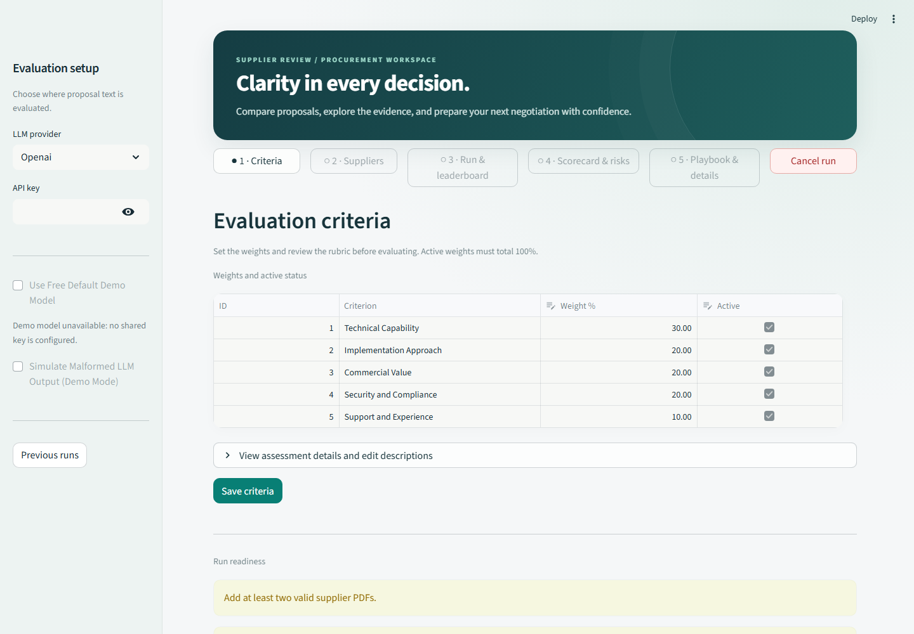
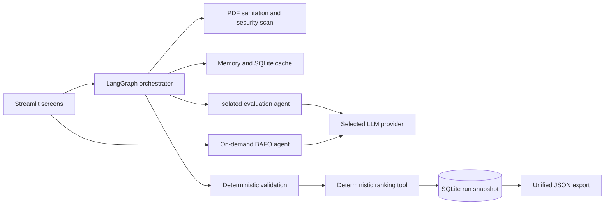

# Agentic RFP Evaluation & Supplier Ranking System

A Streamlit application for evaluating supplier RFP proposals with an auditable, deterministic ranking. An LLM extracts criterion scores, evidence, justifications, and procurement risks from each PDF. Python validates those outputs and performs every calculation and ranking decision. A Best-and-Final-Offer (BAFO) playbook can be generated for the winner after a completed run.

## Features and capabilities

- Evaluate two or more supplier proposals against editable, weighted criteria.
- Upload text-based PDFs or load the fictional demo suppliers. Files are checked for size, page count, encryption, and extractable text; image-only PDFs are rejected because OCR is not supported.
- Use OpenAI, Gemini, Anthropic, or Groq with your own API key, and check connectivity before running an evaluation.
- Review criterion scores, evidence, justifications, warnings, procurement risks, peer benchmarks, gaps, scorecards, and the ranked leaderboard.
- Recompute rankings with the What-If weight simulator. Weight changes reuse validated scores and do not require another LLM call.
- Save and reload previous runs from SQLite, export the unified JSON record, and download a Markdown briefing.
- Generate a winner-focused Best-and-Final-Offer (BAFO) playbook on demand.
- Simulate malformed model output to inspect validation and fallback behavior. This mode makes provider calls and bypasses caches.



## Start locally

Python 3.11 is the deployment target. From this directory:

```powershell
py -3.11 -m venv .venv
.\.venv\Scripts\python.exe -m pip install -r requirements.txt -r requirements-dev.txt
.\.venv\Scripts\python.exe -m scripts.init_db
.\.venv\Scripts\python.exe -m streamlit run app.py
```

On macOS or Linux, create the environment with `python3.11 -m venv .venv` and run commands with `.venv/bin/python`. Open the local address printed by Streamlit, normally `http://localhost:8501`.

The app seeds five criteria on first boot. The SQLite file is `data/rfp_eval.db` unless `RFP_DB_PATH` is set. `make setup`, `make initdb`, `make run`, `make check`, and `make sample-run` provide the same tasks where Make is available.

## Run an evaluation

1. Select a provider in the sidebar and enter your API key. The shared demo option appears only when a deployment has configured both demo secrets.
   The sidebar makes one small connection check for each new provider and key combination. A green dot confirms a live response; a red dot shows a safe failure reason and disables evaluation until you retry or change the key.
   With a verified key, you can enable **Simulate Malformed LLM Output**. It still calls the selected provider for each supplier, injects one validation fault, and skips both cache tiers for that run.
2. Review the five criteria on Screen 1. Save any changes; active weights must total 100%.
3. On Screen 2, click **Load demo suppliers**, or upload at least two text-based PDFs and complete their metadata.
4. On Screen 3, click **Evaluate**. Review the live pipeline, ranked leaderboard, and What-If weights.
5. Use Screen 4 for scorecards, a supplier-versus-peer score chart, evidence, and filterable Risk Radar cards with a severity chart. Screen 5 shows warnings, explanations, JSON export, and the on-demand BAFO playbook and Markdown briefing. The results screen compares leader and runner-up PPI. After evaluation, you can revisit its saved leaderboard in review mode. **Cancel run** starts a fresh session workflow while retaining completed runs.

Open **Previous runs** from the sidebar to reload a completed ranking without another model call. Failed runs appear with their status. Local history lives in SQLite; Community Cloud's ephemeral disk may erase it after an app restart, so download the unified JSON for a durable copy.

The included PDFs and metadata are fictional. [`sample_data/sample_run.json`](sample_data/sample_run.json) is a reproducible four-supplier export generated with the offline fake client. It illustrates the data contract and is not a live model assessment. Regenerate it with `make sample-run` or `.venv\Scripts\python.exe -m scripts.export_sample_run`.

## Architecture



The layers and module contracts are specified in [`architecture.md`](architecture.md); requirements and acceptance criteria are in [`PRD.md`](PRD.md). The implementation rules are in [`AGENTS.md`](AGENTS.md).

## Scoring and ranking

For active criterion `c`, weight `w`, score `s`, maximum score `m`, and peer benchmark `b = max(s)`:

```text
absolute score = sum((s / m) * w)
gap            = s - b
relative %     = (s / b) * 100, when b > 0; 100 when b = 0 and s = 0
PPI            = sum(relative % * (w / total active weight))
```

The absolute score and peer performance index (PPI) are rounded half up to two decimals before ranking. Ties resolve by higher PPI, earlier submission date, higher experience rating, then case-insensitive supplier name. Ranks are unique and sequential. The formulas and exact explanation formats are frozen in [`architecture.md` §10](architecture.md#10-scoring-ranking-and-tie-break).

## Providers and data handling

Bring your own key for OpenAI, Gemini, Anthropic, or Groq. Only the selected provider receives the sanitised text of a proposal, one supplier at a time. Evaluation prompts contain no criterion weights, other suppliers' proposals, or other suppliers' scores. The optional BAFO call receives only the winner's proposal and negative benchmark gaps. Keys are held in session or process memory and excluded from logs, SQLite results, and exports. Proposal text is stored with a run in local SQLite to support the on-demand playbook; that file is ignored by Git. Download the unified JSON to retain a run because Community Cloud disk is ephemeral.

The application supports a single user per session; concurrent sessions on one host share the SQLite database. It does not provide user accounts or multi-tenant isolation. Treat uploaded proposals and exported results as sensitive procurement data.

## Security features

- **Bounded PDF intake:** rejects non-PDF, encrypted, oversized, over-limit, and textless documents. The current limits are 10 MB and 15 pages per PDF.
- **Hidden-text handling:** detects white or tiny text spans, removes them from extracted content, and records findings.
- **Prompt-injection mitigation:** scans extracted text for suspicious instructions, flags findings, neutralizes embedded sandbox tags, and wraps proposal text as untrusted content with instructions to treat it as data. Findings do not automatically block a proposal.
- **Supplier isolation:** sends sanitized proposal text to the selected provider one supplier at a time. Evaluation prompts omit weights and all other suppliers' text and scores. BAFO receives the winner's proposal and its negative benchmark gaps.
- **Deterministic validation and ranking:** validates model replies, clips scores to criterion limits, supplies zero-score fallbacks with warnings for malformed supplier output, and computes all benchmarks and ranks in Python.
- **Secret handling:** API keys are kept in session or process memory, wrapped as secret values, redacted from error messages, and excluded from logs, SQLite run records, and exports. Real `.env` and Streamlit secrets files are ignored by Git.
- **Fault-mode isolation:** malformed-output simulation is explicitly enabled, calls the selected provider, and bypasses both cache tiers so simulated failures are not reused.

These controls reduce common risks but do not replace access controls, human review, or an organization-specific security assessment. The application has no authentication or multi-user tenancy.

## Tests and sample data

```powershell
.\.venv\Scripts\python.exe -m ruff check .
.\.venv\Scripts\python.exe -m ruff format --check .
.\.venv\Scripts\python.exe -m mypy rfp_eval
.\.venv\Scripts\python.exe -m pytest -q -m "not live_llm"
```

These are the `make check` gates. Tests use a fake LLM and need no network. Generate the committed synthetic PDFs again with `make samples`. The acceptance steps, including an error case, are in [`docs/walkthrough.md`](docs/walkthrough.md).

## Deploy on Streamlit Community Cloud

Use a dedicated repository containing this project at its root. Set the app entrypoint to `app.py` and select Python 3.11 in Streamlit Community Cloud's deployment settings. `requirements.txt` pins the runtime dependencies and `.streamlit/config.toml` supplies the visual theme. In the app's secret settings, add a low-limit, revocable demo credential if reviewers need the key-free path:

```toml
DEFAULT_LLM_PROVIDER = "openai"
DEFAULT_LLM_API_KEY = "<set in Streamlit Cloud; never commit>"
```

The real `.streamlit/secrets.toml` and `data/*.db` are ignored. The deployment defaults are OpenAI `gpt-4o-mini`, Gemini `gemini-3.8-flash`, Anthropic `claude-sonnet-4-6`, and Groq `openai/gpt-oss-120b`; provider lifecycle changes may require a later update. Defaults can be overridden through `RFP_OPENAI_MODEL`, `RFP_GEMINI_MODEL`, `RFP_ANTHROPIC_MODEL`, and `RFP_GROQ_MODEL`. Validate the deployed app from a fresh browser session using [`docs/walkthrough.md`](docs/walkthrough.md).

## Assumptions and limits

The app supports one user per session while sessions on a host share the SQLite file. It does not OCR scanned PDFs. The synthetic sample export uses a fake client; live provider output and cost vary. A public deployment and key-free reviewer path require a dedicated Git repository, Streamlit Cloud access, and a configured demo key.
